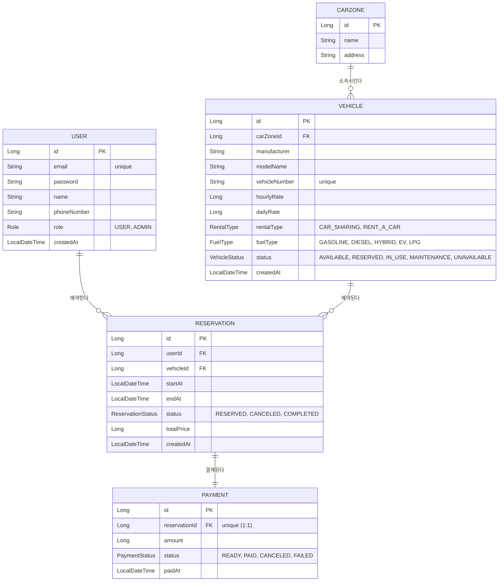

# ERD (Entity Relationship Diagram)

## 관계 설명

- **User 1 : N Reservation** — 한 유저는 여러 예약을 만들 수 있다.
- **Vehicle 1 : N Reservation** — 한 차량은 여러 예약(시간대가 겹치지 않는)을 가질 수 있다.
- **CarZone 1 : N Vehicle** — 한 카존(차량 배치 장소)에는 여러 차량이 소속된다.
- **Reservation 1 : 1 Payment** — 예약 하나에 결제는 하나만 연결된다(`reservation_id`에 unique 제약).

## 참고

- `VehicleGrade`, `CoverageType` enum은 코드에 정의만 되어 있고 아직 어떤 엔티티에도 쓰이지 않는다(추후 확장 여지).
- 모든 enum은 DB에 문자열(`STRING`)로 저장된다.
